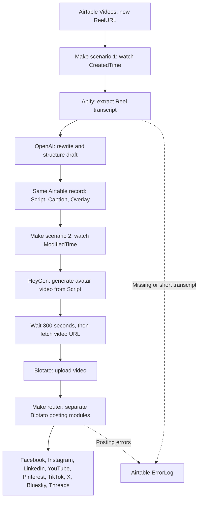

# Blotato social poster

Blotato Social Poster is a social media content automation project that turns an Instagram Reel into a new AI avatar video and distributes it through Blotato. You add the Reel URL to an Airtable table; two Make scenarios handle transcription, script writing, video generation, and publishing to your connected social accounts.

## What this project is for

Creating short videos for several social channels involves repeated work: finding a topic, writing a script, recording a video, preparing captions, and uploading the result to each platform. This project brings those steps into one workflow, with Airtable as the place to submit source content and review the generated copy.

The goal is to help a business, creator, or social media manager turn an existing Reel's spoken content into a fresh script for their audience, produce a video using a configured HeyGen avatar and voice, and use **Blotato to distribute the finished video across social platforms**. It is intended to reduce manual production and posting work without filming a new presentation for every post.

The recovered script prompts are tailored to **UK private medical practices**, aiming for a roughly 30-second script of 60–75 words with a follow call to action. To use the project for another business or audience, update those prompts and configure your own avatar, voice, and social accounts.

## What you put in and what you get out

| Stage | Content |
| --- | --- |
| Input | An Instagram Reel URL entered in the Airtable **Videos** table. |
| Editable draft | A rewritten **Script**, a social post **Caption**, and short **Overlay** text saved to the same record. |
| Video | A portrait AI avatar video generated by HeyGen from the script. Overlay is used as the video title in this export. |
| Distribution | Blotato publishing requests for the configured destinations: Facebook, Instagram, LinkedIn, YouTube, Pinterest, TikTok, X, Bluesky, and Threads. |
| Errors | Missing-transcript and handled posting errors written to **ErrorLog** in Airtable. |

For example, a practice's social media manager could add a Reel discussing a relevant topic, review the rewritten script and caption in Airtable, and then use the video workflow to produce an avatar presentation and distribute it through Blotato. This is an illustrative use case; the recovered workflows have not been tested end to end.

## How you would use it

1. Import the two blueprints into Make and connect Airtable, Apify, OpenAI, HeyGen, and Blotato using the [setup guide](docs/setup.md).
2. Adjust the writing prompts for your audience and select your HeyGen avatar and voice.
3. Connect your social accounts in Blotato and configure the destination branches you want to use.
4. Add a Reel URL to Airtable and run the draft scenario.
5. Review and edit the generated script and caption before sending the content into video generation and publishing.

**Current status:** this repository contains sanitized exports of an existing project and a recovered Airtable structure. Connections need to be restored, and the approval and publication-state safeguards in the setup guide need to be implemented before enabling automation. The existing publishing trigger does **not** enforce the Approved checkbox. Importing and live publishing have not been tested.

## How it works

1. **Reel to draft:** watches new Airtable records, extracts the Reel transcript with Apify, and uses OpenAI to write a Script, Caption, and Overlay back to that record. Missing or short transcripts are logged in ErrorLog.
2. **Avatar to social:** watches modified Airtable records, generates a HeyGen avatar video, uploads it to Blotato, and routes it to Facebook, Instagram, LinkedIn, YouTube, Pinterest, TikTok, X, Bluesky, and Threads.

The second trigger is named “Approved” in the original, but it has no approval filter. Checking Approved is not currently what controls publishing. Follow the setup guide before enabling either scenario.

## Architecture

**Blotato is the publishing layer of this project.** Airtable holds the content, Make runs the automation, Apify extracts the source transcript, OpenAI writes the draft, and HeyGen creates the avatar video. Make then sends that video and the post copy through Blotato to the configured social accounts.

This diagram describes the recovered blueprints. The approval gate and publication tracking described below still need to be implemented.

### What each service does

| Component | Responsibility in this project |
| --- | --- |
| Airtable — Videos table | Stores the source URL, generated draft, intended approval checkbox, timestamps, and errors. It is the shared record between the two scenarios. |
| Make | Watches Airtable, calls the other services, maps their outputs, and routes publishing requests. Both exported JSON files run here. |
| Apify | Extracts the Instagram Reel transcript used by the first scenario. |
| OpenAI | Rewrites the transcript and produces the Script, Caption, and Overlay fields. |
| HeyGen | Turns Script into a portrait avatar video using the configured avatar and voice. Overlay is mapped to the video title. |
| Blotato | Receives the generated video through its media module, then receives platform-specific publishing requests containing the media, post copy, and destination account settings. |
| GitHub | Stores the blueprints, table template, and documentation. It does not run the automation. |

n8n was used to access authorized connections during recovery. It is not part of the runtime architecture of these Make blueprints.

### Scenario 1: source Reel to editable draft

Add an Instagram Reel URL to **ReelURL** in Videos. The first Make scenario watches **CreatedTime**, passes the URL to Apify, and retrieves the transcript. For a usable transcript, OpenAI rewrites the content and returns structured draft fields. Make writes **Script**, **Caption**, and **Overlay** back to the same Airtable record. Missing or short transcripts are recorded in **ErrorLog**.

The record is the handoff between scenarios; the first scenario does not directly call the second. The exported first scenario also contains a two-iteration repeater, so it can generate the draft twice. Review this before running it.

### Scenario 2: draft to video to Blotato publishing

The second Make scenario watches **ModifiedTime** on Videos. It sends **Script** to HeyGen with your avatar and voice IDs, waits 300 seconds, and fetches the generated video's URL. The **Blotato media module** uploads that video. A Make router then feeds separate **Blotato Post modules** for the nine destinations shown above, using the uploaded media and the mapped copy from **Caption** and **Overlay** as configured for each destination.

Your social accounts must be connected in Blotato, and each posting branch must use the corresponding account ID and any required page or board settings. Those private identifiers and connection references were removed from the GitHub exports; reconnect them in Make after importing. Keep only the destination branches you intend to use.

### Approval, state, and errors

The intended operating flow is **add a Reel → generate a draft → review and approve → generate a video → publish through Blotato**. The recovered publishing watcher does **not** enforce the Approved checkbox: any qualifying record modification can enter the second scenario, including draft updates from scenario 1.

Before enabling publishing, add an approval/valid-script filter and processing/publication state. Track success per destination so a retry does not resend posts that already succeeded. Error handlers write to ErrorLog, and because ModifiedTime watches all fields, those writes can trigger the watcher again without state gating. The original fixed wait also needs video-readiness handling before the Blotato upload.

The recovered table has no video-job or publication-status fields, and **BackgroundURL** is retained but unused by these routes. See [Setup and operation](docs/setup.md) for the required changes and a controlled testing sequence.

## Files

- `blueprints/01-reel-to-draft.json` — Make scenario 8198338.
- `blueprints/02-avatar-to-social.json` — Make scenario 8199854.
- `airtable/schema.json` — recovered field specification; a reference, not a complete Airtable API creation payload.
- `airtable/videos-template.csv` — empty CSV header for editable fields.
- [Setup and operation](docs/setup.md) — connections, field mapping, required fixes, and testing.

The Videos table was recreated in the owner's Google Business Profile Posts base on 8 November 2026. The original records were unavailable; no historical rows are included. The live scenarios were not repointed or enabled.

## Related official tutorial

Blotato's [Make AI Social Media System tutorial](https://help.blotato.com/integrations-and-automation-templates/make.com/make-ai-social-media-system) explains importing Make blueprints, connecting Blotato and HeyGen, and configuring accounts. Its example uses Google Sheets and articles, so it is a related reference rather than the exact Airtable/Reels project recovered here. See its [video walkthrough](https://www.youtube.com/watch?v=4FAHV19KwKQ) and the [Blotato API documentation](https://help.blotato.com/api/start).

## Export handling

Credentials, Make connection references, cached sample data, original Airtable IDs, and social account/avatar/voice identifiers were removed or replaced with placeholders. Disconnected designer-only modules were omitted. Connected routes and error handlers were preserved, including the limitations documented in the setup guide. Store credentials in service connections, never in this repository.
