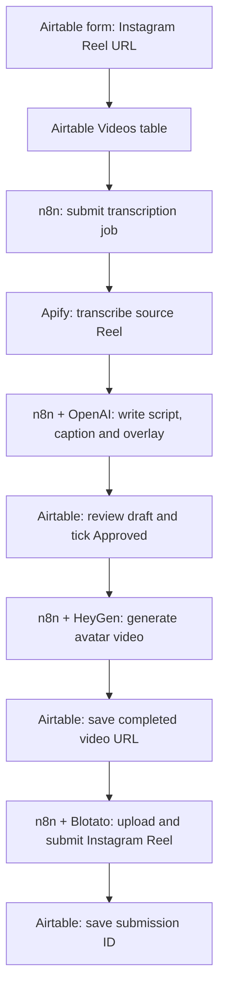

# Blotato social poster

Turn an Instagram Reel link submitted through Airtable into a new scripted avatar video, then publish the approved video through **Blotato**. This is a content repurposing workflow: it transcribes the source Reel, writes a fresh script and caption, and uses HeyGen to produce a new video.

The original project ran in Make. This repository preserves those blueprints and includes the replacement n8n workflows mapped to the current Airtable `Videos` table.

## Architecture

- **Airtable** is the submission queue and review screen. The form creates a record containing `ReelURL`; the automation writes the draft and progress back to that record.
- **n8n** coordinates the API calls and selects records by their status. Each stage is currently a separate manually executed workflow.
- **Apify** retrieves the source Reel's transcript using the actor recovered from the Make scenario.
- **OpenAI** turns the transcript into `Script`, `Caption` and `Overlay`. The recovered editorial direction is UK English, with private medical practice examples where appropriate. Edit the prompt for another audience.
- **HeyGen** generates a vertical avatar video from the approved script. Avatar: `fdfdac1ecc70459fa82dfd7414c04031`. The saved voice is `dd57a636473349dbacc4707bdf6c0558`; access and compatibility still need a live test.
- **Blotato** is the publishing service. It receives the generated video and caption and submits the Reel to the connected Instagram account. It does not transcribe or generate the avatar video.
- **GitHub** stores the workflow definitions and instructions; it does not execute them.

## Current deployment status

Five n8n workflows have been saved and mapped to the live Airtable table. They are **manual, inactive and not yet tested end to end**. The submitted Reel is waiting for processing. n8n still needs the Apify, HeyGen and Blotato credentials before that test can run. Airtable and OpenAI credentials are already selected.

The n8n implementation currently covers **Instagram only**. The archived Make publisher has nine destination branches; those additional destinations have not been migrated. Form submission alone does not yet start these manual workflows. Scheduling and unattended operation remain to be implemented and tested.

[Airtable Videos table](https://airtable.com/appiq7FM7pHODREYL/tblCKulXNvW47zIsS) in **Google Business Profile Posts**.

| Stage | Live workflow | Input → output status |
| --- | --- | --- |
| 1 | [Submit Reel for transcription](https://n8n.faithnte.com/workflow/CUNgUK8NO39EzgIK) | Blank status → Transcribing |
| 2 | [Transcript to draft](https://n8n.faithnte.com/workflow/0BvfGtgyepf58ugg) | Transcribing → Drafting → Draft |
| 3 | [Approved draft to HeyGen](https://n8n.faithnte.com/workflow/sFYGp3wQXQfIfB8j) | Draft + Approved → Generating |
| 4 | [Check HeyGen video](https://n8n.faithnte.com/workflow/6SlbFxGaJtnG5jUl) | Generating → VideoReady |
| 5 | [Publish approved Instagram Reel](https://n8n.faithnte.com/workflow/Utx7OJJsGOhzCKJM) | VideoReady + Approved → Publishing → Submitted |

## Configure and run

1. On a new instance, import `n8n/01-workflow.json` through `05-workflow.json`. On the existing instance, use the linked workflows above instead of importing duplicates.
2. Select the Airtable and OpenAI credentials on their HTTP Request nodes. The exports contain credential names, never API keys. The deployed workflows target base `appiq7FM7pHODREYL`, table `tblCKulXNvW47zIsS`; change these URLs when using a different base.
3. Create these **Header Auth** credentials in n8n and select them on the corresponding HTTP Request nodes:

   | Credential name | Header | Value |
   | --- | --- | --- |
   | Apify | `Authorization` | `Bearer YOUR_APIFY_TOKEN` |
   | HeyGen | `X-Api-Key` | Your HeyGen API key |
   | Blotato | `blotato-api-key` | Your Blotato API key |

4. Confirm that the HeyGen account can use the saved avatar and voice, and that Blotato Instagram account ID `24024` is the intended destination.
5. Submit an Instagram Reel link through the Airtable form, or create a row with `ReelURL`. Leave `Status` and `Script` blank.
6. Execute stage 1 once. It starts an Apify job and saves its run and dataset IDs. Execute stage 2 after transcription finishes; it exits without changes if the job is still running.
7. Review and edit `Script`, `Caption` and `Overlay` in Airtable, then tick `Approved`. Execute stage 3 once to start HeyGen generation.
8. Execute stage 4 until the video is complete. Open `VideoURL` to review it. Untick `Approved` if it should not be published.
9. Execute stage 5 to submit the approved video to Instagram through Blotato. This is a real publishing action, not a preview.

`Submitted` means Blotato accepted the request. It does **not** confirm publication. Check the submission in Blotato; the current workflows do not poll its final status or populate `PublishedURL`.

## Airtable fields and recovery

The table uses `ReelURL`, optional `BackgroundURL`, `Script`, `Caption`, `Overlay`, `Approved`, `CreatedTime`, `ModifiedTime` and `ErrorLog`. Progress fields added for n8n are `Status`, `ApifyRunId`, `ApifyDatasetId`, `HeyGenVideoId`, `VideoURL`, `BlotatoSubmissionId` and `PublishedURL`.

Each execution selects at most one matching row. Do not run the same stage concurrently: Airtable status updates are not an atomic lock. Before a billable request, a stage changes the status to indicate work has started. If a request fails, inspect the n8n execution and the provider's job history before resetting that status; blindly retrying can create duplicate jobs or posts. Errors currently appear in n8n execution logs and are not automatically written to `ErrorLog`.

The draft stage resets `Approved` to false. The checkbox gates both video generation and publishing, but there is no separate second approval field. There are no automatic retries, schedules or final publication checks in this initial migration.

## Repository contents

- `n8n/`: the five replacement workflow exports and live deployment links.
- `blueprints/`: sanitized original Make scenario exports, retained for reference.
- `airtable/`: recovered table schema and blank import template. The schema predates the added n8n progress fields listed above.
- `docs/setup.md`: historical Make setup instructions; use the n8n instructions above for the replacement deployment.

Original scenarios: [script generation](https://eu2.make.com/1627324/scenarios/8198338/edit) and [video publishing](https://eu2.make.com/1627324/scenarios/8199854/edit). Their fixed waits, repeated processing and incomplete approval filtering are reasons to review them before reuse.

## Related documentation

[Blotato's Make AI social media tutorial](https://help.blotato.com/integrations-and-automation-templates/make.com/make-ai-social-media-system) describes a related system based on Sheets/articles, rather than this exact Airtable/Reel project. See also [Blotato API documentation](https://help.blotato.com/api/start) and [HeyGen API documentation](https://developers.heygen.com/llms.txt).
